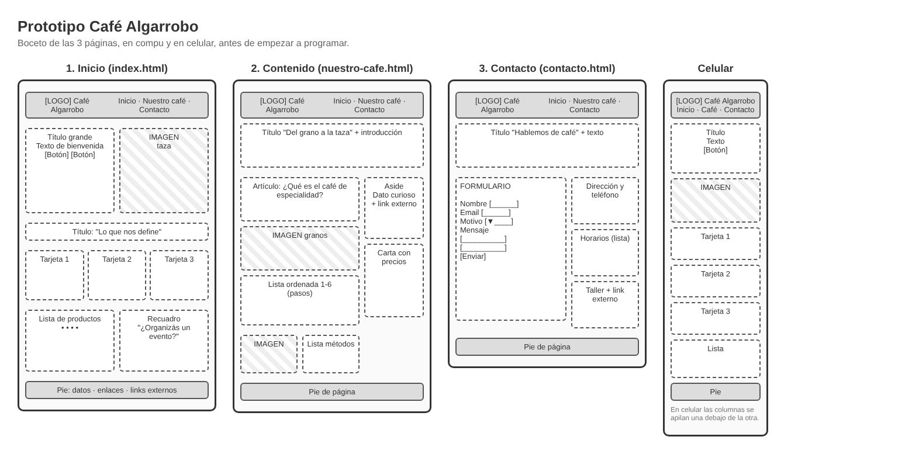

# Café Algarrobo ☕

Trabajo final del Módulo 1: un sitio web estático de 3 páginas hecho con HTML, CSS y Bootstrap.

🔗 **Ver el sitio:** https://tobbias-dev.github.io/cafe-algarrobo/

## De qué se trata

Elegí hacer la página de una empresa ficticia: Café Algarrobo, una cafetería de especialidad que tuesta su propio café.

El sitio tiene tres páginas:

- **Inicio** (`index.html`): presentación del café, tres tarjetas con lo que lo caracteriza y los productos más pedidos.
- **Nuestro café** (`nuestro-cafe.html`): un artículo sobre el café de especialidad, los pasos desde la cosecha hasta la taza y la carta con precios.
- **Contacto** (`contacto.html`): un formulario con nombre, correo y mensaje (por ahora es solo diseño, no envía nada) y los datos del local.

## Qué usé

- HTML con etiquetas semánticas (`header`, `nav`, `main`, `section`, `article`, `aside`, `footer`).
- CSS propio en `css/estilos.css`: colores, fuentes de Google Fonts, clases propias como `boton-cafe`, `tarjeta-cafe` o `hero-cafe`, y algunos efectos (las tarjetas se levantan al pasar el mouse, los botones crecen un poco y la taza de la portada flota).
- Bootstrap 5 para las columnas y el formulario.
- Media queries para que se vea bien en el celular.

Las imágenes (el logo y las ilustraciones) son SVG y están en la carpeta `img`.

## Prototipo

Antes de arrancar hice un boceto de cómo iba a quedar cada página, en compu y en celular:

## Autor

Tobías Uriel Barmaimon
